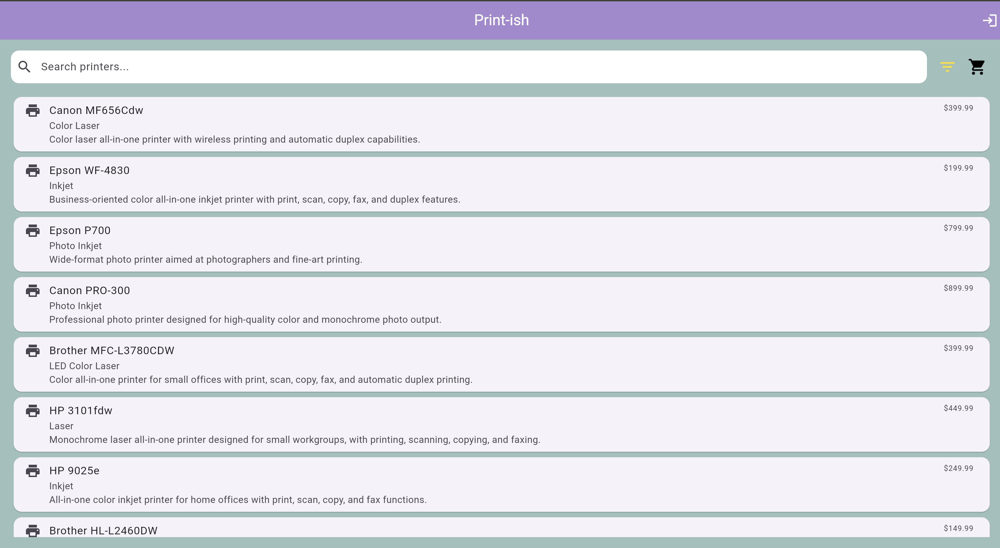
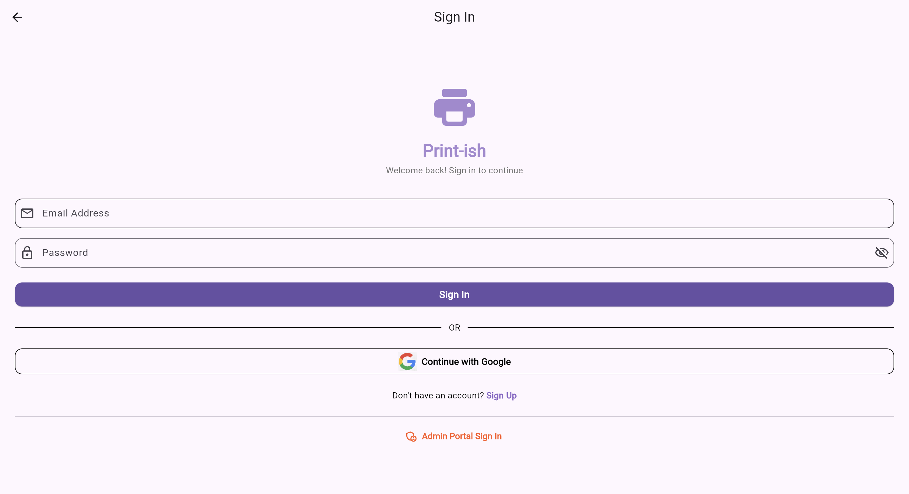
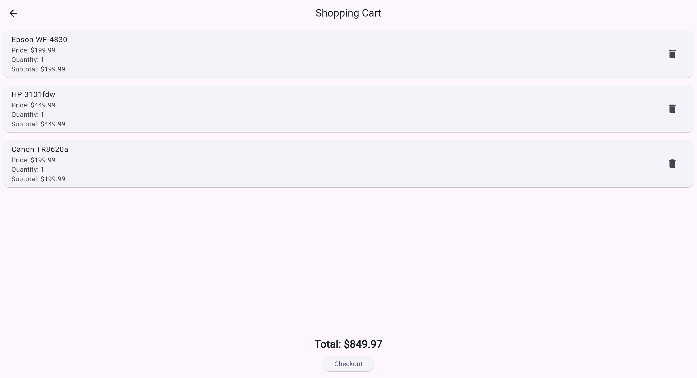
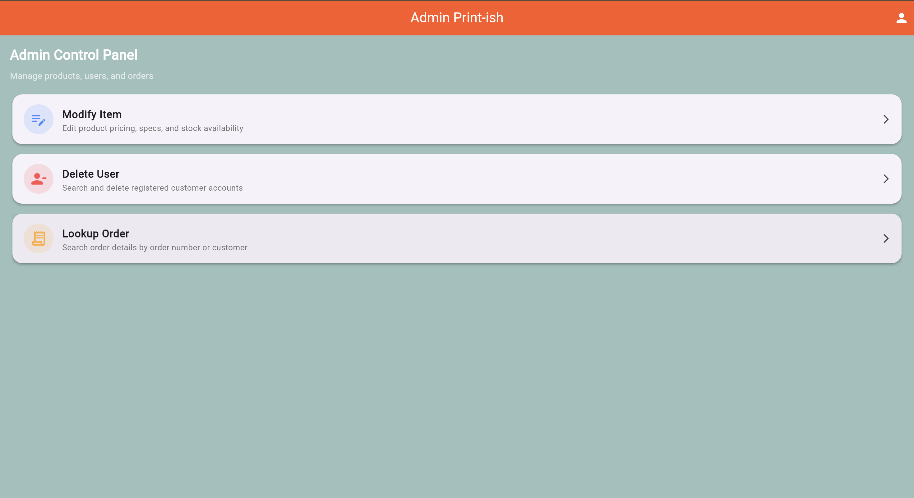

# Print-ish Mobile & Web Application

**Print-ish** is a modern, cross-platform e-commerce Flutter application designed for university students, faculty, and administrators to browse, customize, and order 3D printing equipment, materials, and custom printing services. Built with a responsive Flutter Material 3 UI and powered by Supabase for cloud database, authentication, and Row-Level Security (RLS), Print-ish features guest browsing with lazy authentication, dual customer/admin login portals with Google OAuth v7, interactive catalog search and multi-filtering (by brand, type, and price range), shopping cart and checkout processing with auto-filled user email, and a comprehensive Administrator Control Panel for inventory management, customer account deletion, and order history lookups.

---

## App Screenshots

| Customer Storefront & Guest Browsing | Authentication & Google OAuth |
| :---: | :---: |
|  |  |

| Shopping Cart & Checkout | Admin Control Panel |
| :---: | :---: |
|  |  |

---

## Getting Started: Setup & Run Instructions

### Prerequisites
* [Flutter SDK](https://docs.flutter.dev/get-started/install) (v3.13.5 or higher)
* [Dart SDK](https://dart.dev/get-started/sdk) (v3.13.5 or higher)
* Google Chrome (for web target) or Android Studio / Xcode (for mobile emulators)

### Installation & Setup

1. **Clone the Repository:**
   ```bash
   git clone https://github.com/isaiahrivera1127-del/print-ish-app.git
   cd print-ish-app
   ```

2. **Install Flutter Dependencies:**
   ```bash
   flutter pub get
   ```

3. **Run Automated Test Suite:**
   Run the automated unit and boundary tests:
   ```bash
   flutter test
   ```

4. **Run the Application:**
   * **In Chrome / Web Browser:**
     ```bash
     flutter run -d chrome
     ```
   * **On Mobile Emulator / Device:**
     ```bash
     flutter run
     ```

5. **Build Release Distribution Bundle:**
   Generate the production web release build:
   ```bash
   flutter build web --release
   ```
   *(The output release files will be located in `build/web/`).*

---

## Known Issues & Future Work

### Known Issues
* **Web OAuth Redirect Ports:** When running Flutter Web in debug mode (`flutter run -d chrome`), local ports are dynamically assigned. Ensure `redirectTo: Uri.base.origin` is passed during Google Sign-In initialization and wildcard redirect URIs (`http://localhost:*`) are configured in Supabase.
* **Cascade Account Deleting:** Deleting a customer row from `public.profiles` requires the PostgreSQL `handle_deleted_profile` trigger in Supabase to automatically purge the corresponding row in `auth.users`.

### Future Work & Planned Enhancements
* **Interactive Printer Recommendation Quiz:** Integrate a 3-step recommendation questionnaire ("Find My Printer") to help novice buyers select the right printer model (deferred from MVP in Change Request CR-01).
* **Payment Gateway Integration:** Integrate live payment processing via Stripe, Apple Pay, and Google Pay.
* **Real-time Order Status Push Notifications:** Implement push notifications to alert customers as 3D printing orders progress from processing to printing and delivery.
